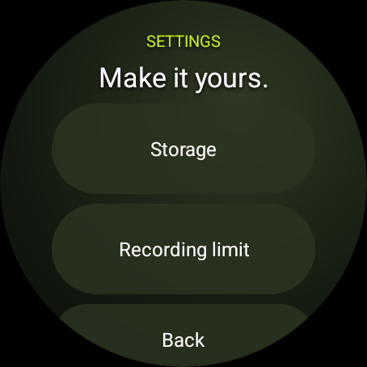

# Remember

An experimental, standalone Wear OS audio recorder designed for round watches, with the Galaxy Watch 7 as the primary design target. Capture a thought or the sounds around you, keep bookmarks, and listen back on the watch. No phone app or account is required.

## Preview

Screenshots from a Wear OS round-screen emulator:

<p>
  
  
  
</p>

## Features

- One-tap microphone recording, pause/resume, and on-watch playback.
- Timestamp bookmarks, renaming, and deletion with confirmation.
- Recording continues in a microphone foreground service when the screen turns off or you leave the app.
- Floating rounded numerals show captured minutes; the background sweep shows seconds within the current minute.
- A live microphone edge meter and an interactive bookmark/playback edge.
- Device and app storage monitoring with a large proportional chart.
- Optional minute limits: save and stop, or save each clip and start the next at zero.
- Native controls, spoken descriptions for custom visuals, and rotary input.

The appearance is inspired by Samsung's [Spatial Number watch face](https://galaxystore.samsung.com/geardetail/com.samsung.android.watch.watchface.spatialnumber?langCd=ko). The numerals are original vector paths drawn in code; no Samsung font or wallpaper is bundled. This is an independent project, not an official Samsung app.

## Status and limitations

**Experimental: suitable for development and evaluation.** Build, lint, unit tests, and recording integration tests have passed locally. The UI has been checked on a Wear OS round-screen emulator; recording integration tests used a separate Android emulator. Physical Galaxy Watch 7 validation is still pending.

- Captures microphone sound, not internal system audio or call audio.
- Recordings stay on the watch. Export, phone transfer, and transcription are not implemented.
- Playback pauses when you leave the playback activity.
- A brief gap can occur between automatically split clips.
- Each clip has a 500 MB safety cap; reaching it saves the clip and stops the session.
- The app attempts to recover playable unfinished files after an interruption, but an abrupt shutdown can leave unrecoverable audio.
- Uninstalling removes recordings and preferences. Text currently uses English.

Before relying on long sessions, validate microphone quality, screen-off capture, battery use, interruptions, permissions, and rotary behavior on your physical watch. Repository readiness does not imply production or Play Store release readiness.

## Build from source

### Requirements

- JDK **21**. Android Studio's bundled JDK can be used if it is version 21.
- Android SDK platform **36.1** (`platforms;android-36.1`).
- Android SDK Build Tools **36.1.0** and Platform Tools.
- Android Studio with support for the project's Android Gradle Plugin **9.2.1**, or the command-line tools.
- Internet access for the first build to download Gradle and dependencies.

The Gradle **9.4.1** wrapper is included; a global Gradle installation is unnecessary. AGP provides built-in Kotlin support. The app supports Android API 31 and later and targets API 36.

### Setup

1. Clone or download this repository and open its root folder in Android Studio.
2. Install the SDK packages above in SDK Manager and select JDK 21 for Gradle.
3. Android Studio normally creates the local SDK configuration. For a command-line build, set `ANDROID_HOME` to your SDK directory or create an untracked `local.properties` containing `sdk.dir=/absolute/path/to/android-sdk`.

With Android command-line tools installed, the SDK packages can also be installed using:

```sh
sdkmanager "platform-tools" "platforms;android-36.1" "build-tools;36.1.0"
```

Build and check from the project root:

```sh
./gradlew :app:assembleDebug :app:lintDebug :app:testDebugUnitTest :app:assembleDebugAndroidTest
```

On Windows, use `gradlew.bat` instead of `./gradlew`. The debug APK is generated at `app/build/outputs/apk/debug/app-debug.apk`; generated APKs are not committed.

## Install on a watch or emulator

For an emulator, create a **Wear OS Large Round** device in Android Studio Device Manager, start it, select it as the deployment target, and run the `app` configuration.

For a physical watch:

1. Enable developer options and wireless debugging on the watch.
2. Connect the watch and computer to the same Wi-Fi network.
3. Pair using Android Studio's **Pair Devices Using Wi-Fi**, or use Platform Tools:

```sh
adb pair WATCH_IP:PAIRING_PORT
adb connect WATCH_IP:CONNECTION_PORT
adb -s WATCH_IP:CONNECTION_PORT install -r app/build/outputs/apk/debug/app-debug.apk
```

The pairing and connection ports are different. Read each from the watch's Wireless debugging screens. See [Google's Wear OS Wi-Fi debugging guide](https://developer.android.com/training/wearables/get-started/debug-wifi).

## Using Remember

- **Record:** tap Record and allow microphone access. Allow notifications to make the recording notification and its Save action easy to reach.
- **Pause / Resume:** paused time is excluded from captured duration and minute limits.
- **Mark:** add a timestamp bookmark using the button or by tapping the right edge during capture.
- **Save:** finish and save the current clip.
- **Moments:** browse and play recordings, rename them, or delete them after confirmation. Tap a bookmark to jump to it. The right edge also seeks during playback; the native slider is available as an alternative.
- Swipe vertically or use rotary input to reach controls below the screen.

Audio is stored as mono AAC in M4A files at 44.1 kHz / 128 kbps, approximately 1 MB per minute. The large numeral shows whole minutes in the current recording or playback, and total saved minutes on the home screen. Floating motion stops while capture is paused, the app is in the background, animations are disabled, or battery saver is active.

## Settings

Open **Settings** beside Moments. During capture, scroll below Save to reach it; recording continues while you browse.

### Storage

A large proportional ring fills most of the initial view. Lime is available space, gray is other used storage, and white represents Remember. A small white marker makes a tiny app slice visible without inflating its share. The center shows the percentage free and total capacity. Scroll down for available/app-used amounts, Refresh, and Back.

App usage includes installed app files, recordings, data, and cache. Readings refresh every five seconds while the page is open. Available space follows Android's accounting, including reclaimable cache. If Android's app accounting is unavailable, an approximate app size is marked with `≈`.

### Recording limit

Turn the limit off for unlimited recording by time, or turn it on and choose **1–1,440 minutes** with the picker or rotary input. Disabling it retains your chosen length and action.

Under **At the limit**, choose **Save & stop** to end the recording, or **Save & start next** to continue with a new clip at zero. Split clips have numbered titles and their own bookmarks. Paused time does not count. Changes apply to the next recording session, including all its parts. The 500 MB safety cap applies in either mode.

## Tests and automated checks

Local checks:

```sh
./gradlew :app:assembleDebug :app:lintDebug :app:testDebugUnitTest :app:assembleDebugAndroidTest
```

Device tests require a **disposable** emulator with a microphone. They create audio files and temporarily change preferences. Two tests record for a real minute; do not run them during a personal recording. Ensure only the intended test emulator is connected, because the connected-test task can target every connected device.

```sh
./gradlew :app:connectedDebugAndroidTest
```

Coverage includes duration formatting, limit boundaries, pause exclusion, real one-minute automatic stop and split rollover, playable file output, bookmarks, settings persistence/navigation, storage accounting, and clip rename/delete behavior.

[Android checks](.github/workflows/android.yml) runs on pushes, pull requests, and manual dispatch. It verifies the wrapper, builds the debug app, runs lint and unit tests, and compiles device tests. It uploads check reports and a debug APK with a 14-day retention period. Device tests are run locally; the workflow does not claim to run them. The workflow uses pinned action commits and read-only repository permissions. Its first hosted run will happen after the repository is pushed to GitHub.

## Privacy, contributions, and license

Recordings remain in the app's private local storage. There are no accounts, analytics, ads, or upload features, and no internet permission. See [PRIVACY.md](PRIVACY.md).

See [CONTRIBUTING.md](CONTRIBUTING.md) for development and pull-request guidance. Keep private audio, credentials, signing keys, local IDE/device configuration, and build output out of the repository.

Remember's code and original artwork are released under the [MIT license](LICENSE). Android, Kotlin, Gradle, build plugins, and test dependencies retain their own licenses. See [THIRD_PARTY_NOTICES.md](THIRD_PARTY_NOTICES.md).
