# Remember

An experimental, standalone Wear OS audio recorder designed for round watches, with the Galaxy Watch 7 as the primary design target. Capture a thought or the sounds around you, keep bookmarks, and listen back on the watch. No phone app or account is required.

## Preview

Screenshots from a Wear OS round-screen emulator:

<p>
  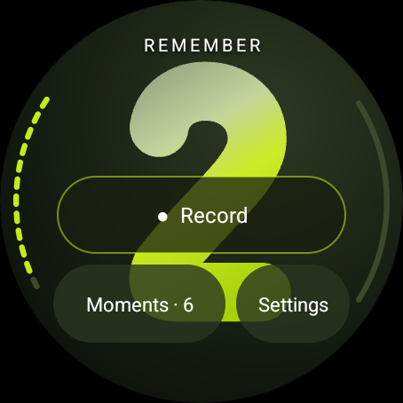
  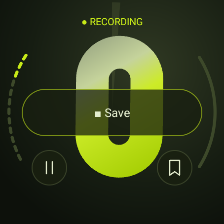
  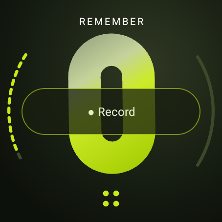
  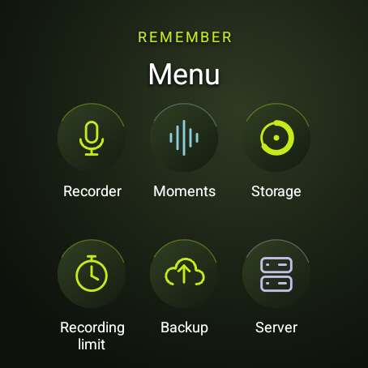
  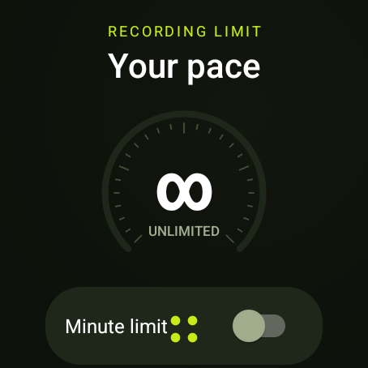
  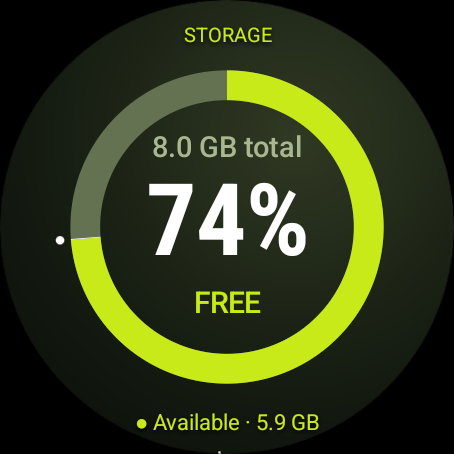
</p>

## Features

- One-tap microphone recording, pause/resume, and on-watch playback.
- Timestamp bookmarks, renaming, and deletion with confirmation.
- A recording Wear OS Tile with one-tap Record, elapsed time, pause/resume, Mark, and Save.
- Recording continues in a microphone foreground service when the screen turns off or you leave the app.
- Floating rounded numerals show captured minutes; the background sweep shows seconds within the current minute.
- A live microphone edge meter and an interactive bookmark/playback edge.
- One shared icon grid opens every section directly, with a fixed Menu shortcut and rotary scrolling.
- Device and app storage monitoring with a large proportional chart.
- Optional SFTP backups to your own server, a transfer queue, scheduled uploads, and remote playback.
- Optional minute limits: save and stop, or save each clip and start the next at zero.
- Native controls, spoken descriptions for custom visuals, and rotary input.

The appearance is inspired by Samsung's [Spatial Number watch face](https://galaxystore.samsung.com/geardetail/com.samsung.android.watch.watchface.spatialnumber?langCd=ko). The numerals are original vector paths drawn in code; no Samsung font or wallpaper is bundled. This is an independent project, not an official Samsung app.

## Status and limitations

**Experimental: suitable for development and evaluation.** Build, lint, unit tests, and recording integration tests have passed locally. The UI has been checked on a Wear OS round-screen emulator; recording integration tests used a separate Android emulator. Physical Galaxy Watch 7 validation is still pending.

- Captures microphone sound, not internal system audio or call audio.
- Recordings stay on the watch unless you configure and trigger SFTP backups. Phone transfer, restore into the local library, and transcription are not implemented.
- Backup is experimental. Your real server and its 128 MB memory budget have not yet been validated.
- Backup generates Ed25519 watch keys and pins the server fingerprint. Existing RSA watch keys remain usable until explicitly replaced. Password login and private-key import are not implemented; RSA, ECDSA, and Ed25519 server host keys are supported.
- Playback pauses when you leave the playback activity.
- A brief gap can occur between automatically split clips.
- Each clip has a 500 MB safety cap; reaching it saves the clip and stops the session.
- The app attempts to recover playable unfinished files after an interruption, but an abrupt shutdown can leave unrecoverable audio.
- Uninstalling removes recordings and preferences. Text currently uses English.

Before relying on long sessions, validate microphone quality, screen-off capture, battery use, interruptions, permissions, and rotary behavior on your physical watch. Repository readiness does not imply production or Play Store release readiness.

## Build from source

### Requirements

- JDK **21**. Android Studio's bundled JDK can be used if it is version 21.
- Android SDK platform **36.1** (`platforms;android-36.1`).
- Android SDK Build Tools **36.1.0** and Platform Tools.
- Android Studio with support for the project's Android Gradle Plugin **9.2.1**, or the command-line tools.
- Internet access for the first build to download Gradle and dependencies.

The Gradle **9.4.1** wrapper is included; a global Gradle installation is unnecessary. AGP provides built-in Kotlin support. The app supports Android API 31 and later and targets API 36.

### Setup

1. Clone or download this repository and open its root folder in Android Studio.
2. Install the SDK packages above in SDK Manager and select JDK 21 for Gradle.
3. Android Studio normally creates the local SDK configuration. For a command-line build, set `ANDROID_HOME` to your SDK directory or create an untracked `local.properties` containing `sdk.dir=/absolute/path/to/android-sdk`.

With Android command-line tools installed, the SDK packages can also be installed using:

```sh
sdkmanager "platform-tools" "platforms;android-36.1" "build-tools;36.1.0"
```

Build and check from the project root:

```sh
./gradlew :app:assembleDebug :app:lintDebug :app:testDebugUnitTest :app:assembleDebugAndroidTest
```

On Windows, use `gradlew.bat` instead of `./gradlew`. The debug APK is generated at `app/build/outputs/apk/debug/app-debug.apk`; generated APKs are not committed.

## Install on a watch or emulator

For an emulator, create a **Wear OS Large Round** device in Android Studio Device Manager, start it, select it as the deployment target, and run the `app` configuration.

For a physical watch:

1. Enable developer options and wireless debugging on the watch.
2. Connect the watch and computer to the same Wi-Fi network.
3. Pair using Android Studio's **Pair Devices Using Wi-Fi**, or use Platform Tools:

```sh
adb pair WATCH_IP:PAIRING_PORT
adb connect WATCH_IP:CONNECTION_PORT
adb -s WATCH_IP:CONNECTION_PORT install -r app/build/outputs/apk/debug/app-debug.apk
```

The pairing and connection ports are different. Read each from the watch's Wireless debugging screens. See [Google's Wear OS Wi-Fi debugging guide](https://developer.android.com/training/wearables/get-started/debug-wifi).

## Using Remember

- **Record:** tap Record and allow microphone access. Allow notifications to make the recording notification and its Save action easy to reach.
- **Pause / Resume:** use the small floating pause/play icon below the main button. Paused time is excluded from captured duration and minute limits.
- **Mark:** add a timestamp bookmark using the button or by tapping the right edge during capture.
- **Save:** finish and save the current clip.
- **Moments:** browse and play recordings, rename them, or delete them after confirmation. Tap a bookmark to jump to it. The right edge also seeks during playback; the native slider is available as an alternative.
- Swipe vertically or use rotary input to reach controls below the screen.

The app keeps **Record / Save** in one fixed position. Small **Pause / Resume** and **Mark** icons appear below it during capture, with 48 dp tap areas around 36 dp circles. Labels fade and the icons gently rise into place without rebuilding the screen or restarting the floating numeral. These short transitions respect animation and battery-saver preferences.

Audio is stored as mono AAC in M4A files at 44.1 kHz / 128 kbps, approximately 1 MB per minute. The large numeral shows whole minutes in the current recording or playback, and total saved minutes on the home screen. Floating motion stops while capture is paused, the app is in the background, animations are disabled, or battery saver is active.

## Current recording tile

Add **Remember → Current recording** from the watch's **Add tiles** screen (swipe through your tiles from the watch face). The tile mirrors the app’s home/recording screen: original rounded minute artwork behind translucent controls, an olive dial with a half-circle seconds sweep, and one fixed main button that changes from **Record** to **Save**. During capture, small floating **Pause / Resume** and **Mark** icons sit below it, each with a 48 dp tap area. The label fades between states and the floating controls fade and gently rise into place; the page and main button stay still. These short, system-rendered transitions are omitted when animations are disabled or battery saver is active. Older tile renderers use the same layout without transitions. The left edge indicates capturing/paused state and the right edge lights up for bookmarks (up to twelve visible marks). The status has spoken part and full bookmark counts. These controls work directly in the tile while the recording service continues in the background. It has no library, backup, or settings controls.

With no active recording, the tile shows the **REMEMBER** heading, a zero numeral, and **Record**. Tap **Record** to begin and stay on the tile. A brief transparent activity handles Android’s foreground microphone requirements; it asks for microphone access only when needed and returns to the tile after capture starts. Denying access leaves recording stopped. Wear OS controls this permission/start handoff; older tile hosts may briefly show their system launch transition. Ordinary app launches do not start capture. Paused time is excluded. Saving or reaching a stop limit returns the tile to idle; automatic splitting switches it to the new part at zero. Delayed commands for a previous clip are ignored.

The system renderer advances the seconds sweep and spoken time once per second on hosts supporting dynamic expressions (Wear OS 4+); older hosts show a seconds snapshot. Original minute glyphs advance through a one-hour system timeline, with a live numeric fallback if a host retains the tile longer. Tap the numeral to refresh it. State changes request an update, and the tile requests a periodic refresh, but Wear OS controls delivery timing. The app does not poll or run another recording service for the tile. Physical Galaxy Watch tile validation is pending.

<p>
  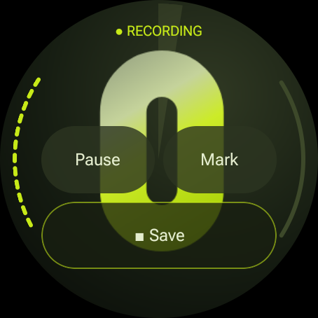
  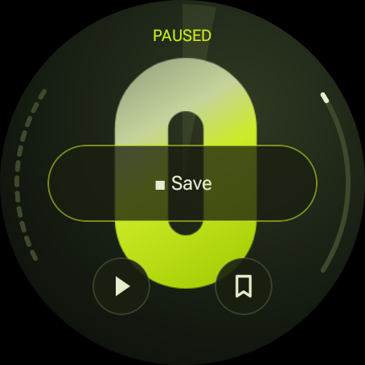
  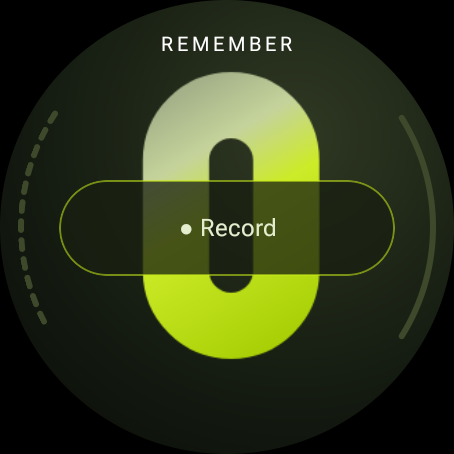
</p>

## Menu and preferences

Open the transparent four-dot **Menu** icon at the bottom center of the home or recording screen. A three-column icon grid opens Recorder, Moments, Storage, Recording limit, Backup, Server, Transfers, Server recordings, Automatic backup, and Advanced directly. Scroll or use rotary input for the lower rows. The transparent Menu shortcut floats over full-screen pages without a reserved footer bar. Touch the screen to reveal it; it hides after three seconds without interaction. Rotary input also reveals it. It stays visible for touch exploration and keyboard focus, and respects the system accessibility timeout. Returning preserves your grid position. Back returns to the grid, or to the parent page for a clip, picker, or approval step. Recording continues while you browse.

The library uses recording cards, Backup shows a completion dial, Recording limit shows the configured minutes or an unlimited dial, and Automatic backup shows its interval and whether checks are off. Interval, retry, and timeout choices use inline selected chips. Setup forms and actions remain scrollable.

### Storage

A large proportional ring fills most of the initial view. Lime is available space, gray is other used storage, and white represents Remember. A small white marker makes a tiny app slice visible without inflating its share. The center shows the percentage free and total capacity. Scroll down for available/app-used amounts, Refresh, and Back.

App usage includes installed app files, recordings, data, and cache. Readings refresh every five seconds while the page is open. Available space follows Android's accounting, including reclaimable cache. If Android's app accounting is unavailable, an approximate app size is marked with `≈`.

### Recording limit

Turn the limit off for unlimited recording by time, or turn it on and choose **1–1,440 minutes** with the picker or rotary input. Disabling it retains your chosen length and action.

Under **At the limit**, choose **Save & stop** to end the recording, or **Save & start next** to continue with a new clip at zero. Split clips have numbered titles and their own bookmarks. Paused time does not count. Changes apply to the next recording session, including all its parts. The 500 MB safety cap applies in either mode.

## Backup

Open **Menu → Backup** for the dashboard. **Server**, **Transfers**, **Server recordings**, **Automatic backup**, and **Advanced** are separate buttons in the same menu.

<p>
  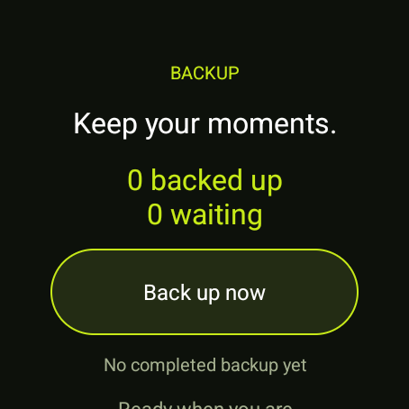
  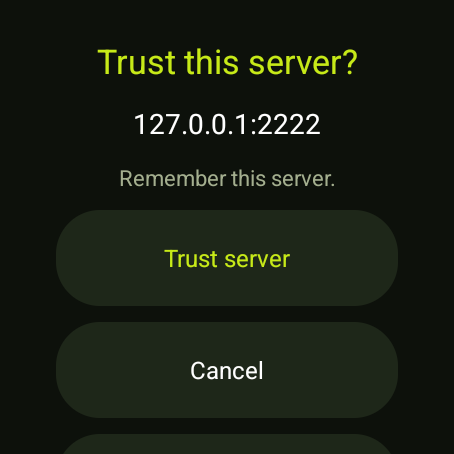
  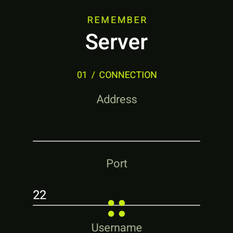
  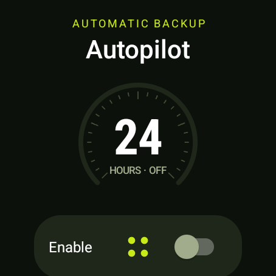
  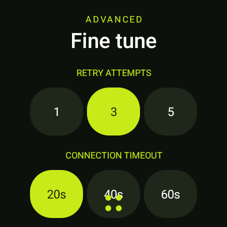
</p>

- **Server:** configure address, port, username, and an existing absolute backup folder. **Connect & trust** fetches the fingerprint without typing; approve the server once to remember it. Create the watch key, open **Show watch key → Show QR code** to scan the public key with your phone, or copy/export it on the watch, then authorize it on your server. The QR works offline and contains only the public key. Test connection before uploading. See [server setup](docs/backup.md).
- **Transfers:** shows saved recordings and their status. **Back up / Retry** queues unfinished or changed recordings. **Pause all** cancels transfers and turns automatic backup off. Local recordings are never deleted by backup; local deletion does not delete server copies.
- **Server recordings:** Refresh lists completed Remember backups (up to 1,000 per folder). Select a recording to download a verified temporary copy and play it with seeking and bookmark buttons. This is cached playback, not live streaming; sufficient watch storage is required. Leaving the activity pauses playback.
- **Automatic backup:** opt in to checks every hour, every six hours, or daily. Charging and unmetered connections are required by default and can be changed. Unmetered does not necessarily mean Wi-Fi. Android schedules work when conditions allow, rather than at an exact clock time; jobs persist across reboot.
- **Advanced:** choose 1/3/5 retry attempts, a 20/40/60-second connection timeout, or clear the playback cache. Server identity shows the remembered fingerprint; Forget trust pauses backups and allows a verified server-key change to be approved again.

Uploads use one SFTP connection at a time and bounded buffers, without a database, HTTP backend, shell commands, or compression. Interrupted audio uploads resume; the completed remote audio is read back and SHA-256 checked before publishing metadata and marking it backed up. This integrity check costs an additional full-file download. Each clip has its own audio file and JSON manifest containing title, duration, bookmarks, byte count, and checksum. Metadata changes queue another backup. Receipts are scoped to server address, account, folder, and pinned host key. A receipt records a successful transfer; it does not continuously check whether a server copy was subsequently removed.

The watch's private SSH key is encrypted using Android Keystore. SSH encrypts transport; audio and metadata on your server are **not encrypted at rest**. End-to-end encryption, exact-time scheduling, bandwidth caps, remote deletion, and restoration into the local library are not implemented. Automatic backup checks periodically for finished clips; saving a clip does not force an immediate upload. Interrupted jobs retain partial files for a later retry, subject to the configured retry limit.

## Backup CLI

The optional **`remember` CLI** works with backup folders over SFTP or on your computer, without a Remember config file or server software. Install it once with `pipx install .` (Python 3.10+), then pass the SSH destination and root directly:

```sh
remember ls backup@backup.example:/srv/remember --search meeting
remember info backup@backup.example:/srv/remember latest
remember sync backup@backup.example:/srv/remember ./recordings
remember verify backup@backup.example:/srv/remember
remember play backup@backup.example:/srv/remember latest
```

It supports bookmarks, JSON output, resumable verified downloads, incremental sync, title edits, recoverable server-side trash, restore, and explicit permanent purge. Host-key checks are required; your computer uses its own SSH key or agent. Sync never propagates remote deletions into local recordings. Pause watch uploads while changing server backups; those edits do not update watch-local titles or receipts. See the [CLI guide](docs/cli.md) for installation alternatives, every command, and safety/compatibility details. This is a separate desktop tool; Python is not added to the watch APK.

## Tests and automated checks

Local checks:

```sh
./gradlew :app:assembleDebug :app:lintDebug :app:testDebugUnitTest :app:assembleDebugAndroidTest
```

Device tests require a **disposable** emulator with a microphone. They create audio files and temporarily change preferences. Two recording-limit tests and one tile minute-rollover test each record for a real minute; do not run them during a personal recording. Ensure only the intended test emulator is connected, because the connected-test task can target every connected device.

```sh
./gradlew :app:connectedDebugAndroidTest
```

Coverage includes backup destination validation, encrypted watch-key persistence, the shared menu, direct section navigation and back behavior, backup-page navigation, manifest safety, and (with an opt-in disposable SFTP fixture) resumable transfers, checksum verification, host-key rejection, actual scheduled uploads, scheduling constraints, and cached remote playback/background pause. Network fixture instructions are in [docs/backup.md](docs/backup.md). Coverage also includes one-tap tile recording, microphone denial/approval (on a fresh disposable watch before permission is granted; otherwise skipped), the actual Wear OS tile carousel, live/paused timing, direct recording controls, screen-off capture, stale-command rejection, tile layout bounds, duration formatting, limit boundaries, pause exclusion, real one-minute automatic stop and split rollover, playable file output, bookmarks, settings persistence/navigation, storage accounting, and clip rename/delete behavior.

[Android checks](.github/workflows/android.yml) runs on pushes, pull requests, and manual dispatch. It verifies the wrapper, builds the debug app, runs lint and unit tests, and compiles device tests. It uploads check reports and a debug APK with a 14-day retention period. Device tests are run locally; the workflow does not claim to run them. The workflow uses pinned action commits and read-only repository permissions. Its first hosted run will happen after the repository is pushed to GitHub.

## Privacy, contributions, and license

Recordings use private local storage, with optional uploads to your own SFTP server. Automatic backups are off by default. There are no app accounts, analytics, or ads. See [PRIVACY.md](PRIVACY.md).

See [CONTRIBUTING.md](CONTRIBUTING.md) for development and pull-request guidance. Keep private audio, credentials, signing keys, local IDE/device configuration, and build output out of the repository.

Remember's code and original artwork are released under the [MIT license](LICENSE). Android, Kotlin, Gradle, build plugins, and test dependencies retain their own licenses. See [THIRD_PARTY_NOTICES.md](THIRD_PARTY_NOTICES.md).
